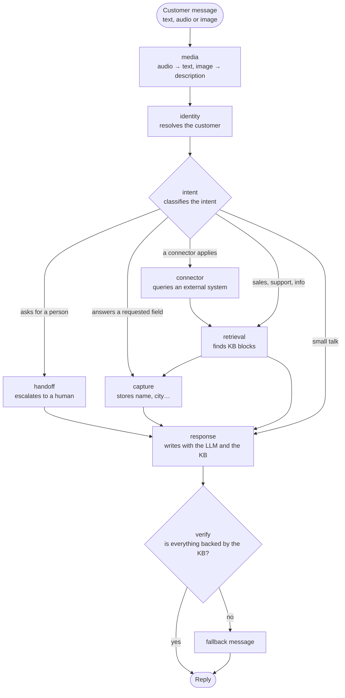

# Generic AI support/sales agent for messaging channels

[Español](README.md) · English

A support and sales chat agent for a web chat or WhatsApp Cloud API. It answers **only from the business's knowledge base**, verifies its replies before sending them, hands off to a person when needed, and is measured against a set of golden cases. It is a template: one business = one deployment, and everything specific to the business lives in a `tenant.yaml`.

## Features

- **LangGraph orchestration**: intent → data capture → retrieval (RAG) → response → verification.
- **Anti-hallucination**: a second LLM pass checks the reply against the KB and the data before it is sent; a scope rule refuses anything outside the business.
- **Human handoff** when the customer asks for a person or the KB cannot solve the case.
- **Audio and images in the web chat**: the agent transcribes voice notes and describes photos with a multimodal model.
- **Swappable LLM provider**: Groq, Google, Anthropic or OpenRouter, with retries and size limits.
- **Web console** (React 19): chat simulator with traces, knowledge base, editable prompts, connectors, evaluation and the graph.
- **Golden-case evaluation**, no LLM judge: every prompt, model or KB change is measured against the same cases.

## How a turn works



`media` and `verify` are optional (`media_enabled` and `verify_responses` in the tenant). The rest of the graph knows nothing about WhatsApp or any LLM provider; it only sees state and contracts.

## Evaluation results

The example is a fictional business, **"Lumbre Café"**, with 39 golden cases in [`golden.yaml`](agent-ai-backend/examples/coffee-shop/golden.yaml). Each case fixes which facts the reply must contain, what it must not claim, whether it must hand off to a person, and which KB block should have been retrieved. Run it with `uv run python -m scripts.run_golden`.

**Latest full run** (3 Nov 2026, `openai/gpt-oss-120b` on Groq):

| Metric | Value |
|---|---|
| Cases solved | **39/39** (95 % confidence interval: 91 % to 100 %) |
| Correct handoff (of those that should go to a person) | 100 % |
| Unnecessary handoffs (out of 5 that should not) | 0 |
| Retrieved the right KB block | 100 % |
| Claimed nothing forbidden | 100 % |
| Average seconds per case | 5.1 |

| Category | Solved |
|---|---|
| Prices | 3/3 |
| Products | 3/3 |
| Subscription | 4/4 |
| Shipping | 4/4 |
| Payments | 1/1 |
| Returns | 3/3 |
| Opening hours | 2/2 |
| Small talk (no over-escalation) | 2/2 |
| Multi-turn | 3/3 |
| Handoff to a person | 4/4 |
| Out of scope (no invention) | 6/6 |
| Security and pressure | 4/4 |

**History.** The first measurement scored **36/39**: three real failures (it lost context on a follow-up question, "And the 250 g one?", and answered off-topic questions such as the capital of France or a recipe). They were fixed and the second run scored 39/39. Details in [`docs/eval-baseline.md`](agent-ai-backend/docs/eval-baseline.md) (Spanish).

**How to read the 100 %.** The cases were tuned while the agent was being fixed, so this is a development set, not a blind test, and with 39 cases the interval is wide. That run predates two changes: a tweak to how a request for a person is detected during data capture, and the move to OpenRouter with `google/gemini-2.5-flash-lite` as the example model. Neither has been re-measured with the 39 cases. If you change the model, re-run the golden set and update this table.

## Quickstart

```bash
cp agent-ai-backend/.env.example agent-ai-backend/.env   # fill in your keys
docker compose up --build
```

Backend on `:8000`, frontend on `:5173`. Without Docker: `./scripts/start-demo.sh`. Tests: `cd agent-ai-backend && uv run pytest`, and `pnpm exec playwright test` in the frontend.

## Configuring the model

In `tenant.yaml`, `llm` block (the key goes in the environment, never in the file):

```yaml
llm:
  provider: openrouter            # or groq, google, anthropic
  model: google/gemini-2.5-flash-lite
media_enabled: true               # audio and images (the model must be multimodal)
verify_responses: true            # anti-hallucination verifier (+1 call per turn)
```

| Provider | Environment variable |
|---|---|
| `openrouter` | `OPENROUTER_API_KEY` |
| `groq` | `GROQ_API_KEY` |
| `google` | `GOOGLE_API_KEY` |
| `anthropic` | `ANTHROPIC_API_KEY` |

Audio requires the OpenRouter account to hold a balance (at least $0.50). Browser voice notes are converted with `ffmpeg`, which the backend Docker image already includes.

## Layout

- `agent-ai-backend/` — API and agent (Python, FastAPI, LangGraph). See [`agent-ai-backend/README.md`](agent-ai-backend/README.md) and the [new-tenant guide](agent-ai-backend/docs/new-tenant-guide.md) (Spanish).
- `agent-ai-frontend/` — web console (React 19, Vite, Tailwind). `pnpm install && pnpm dev` from that folder.

## Known limits

- The example runs with `auth.mode: disabled` (local development only). In production use `auth.mode: firebase` and `cors.allowed_origins`; with open auth anyone can edit the KB and the prompts.
- Only tested with SQLite. For Postgres you need to test the migrations and replace the conversation checkpointer (`MemorySaver`, lost on restart).
- Default prompts are not applied automatically to a database that already has them seeded: update them through the API or the prompts screen.
- There is no per-user rate limit: for a public demo, add one and put a spending cap on the LLM key.

## Contributing & security

See [CONTRIBUTING.md](CONTRIBUTING.md) and [SECURITY.md](SECURITY.md). License: [MIT](LICENSE).
