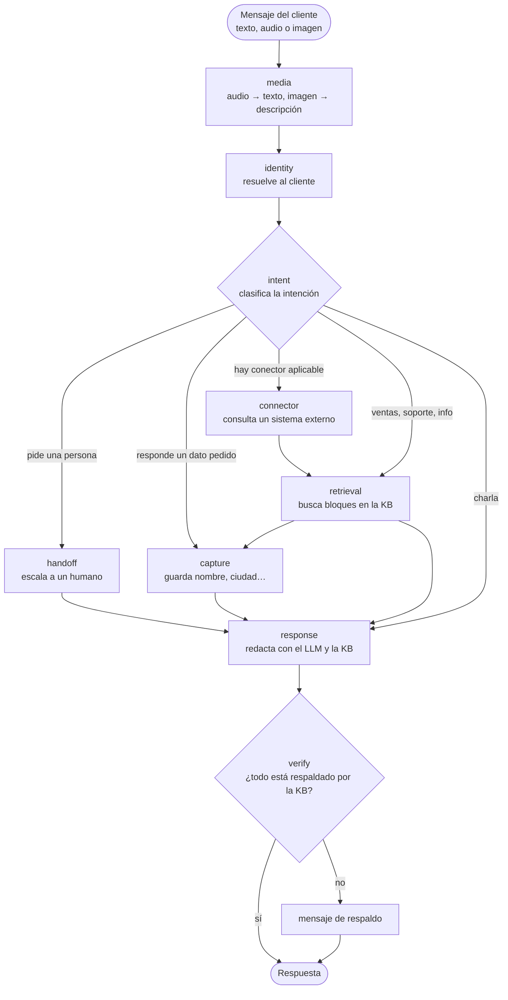

# Agente IA genérico de soporte/ventas por mensajería

[](https://github.com/ErickPenafiel/chat-agent-ai/actions/workflows/ci.yml)
[](LICENSE)

Español · [English](README.en.md)

Agente conversacional de soporte y ventas que atiende por un chat web o por WhatsApp Cloud API. Responde **solo con la base de conocimiento del negocio**, verifica sus respuestas antes de enviarlas, pasa a una persona cuando hace falta y se mide con un conjunto de casos dorados. Es una plantilla: un negocio = un despliegue, y todo lo propio del negocio vive en un `tenant.yaml`.

## Qué tiene

- **Orquestación con LangGraph**: intención → captura de datos → recuperación (RAG) → respuesta → verificación.
- **Anti-alucinación**: un segundo paso del LLM compara la respuesta con la KB y los datos antes de enviarla; una regla de alcance rechaza lo ajeno al negocio.
- **Escalamiento a una persona** cuando el cliente la pide o el caso no se resuelve con la KB.
- **Audio e imágenes en el chat web**: el agente transcribe las notas de voz y describe las fotos con un modelo multimodal.
- **Proveedor de LLM intercambiable**: Groq, Google, Anthropic u OpenRouter, con reintentos y límites de tamaño.
- **Consola web** (React 19): simulador de chat con trazas, base de conocimiento, prompts editables, conectores, evaluación y el grafo.
- **Evaluación con casos dorados**, sin LLM juez: cada cambio de prompt, modelo o KB se compara con la misma vara.

## Cómo funciona un turno



`media` y `verify` son opcionales (`media_enabled` y `verify_responses` en el tenant). El resto del grafo no sabe nada de WhatsApp ni de ningún proveedor de LLM: ve solo estados y contratos.

## Resultados de la evaluación

El ejemplo es un negocio ficticio, **«Lumbre Café»**, con 39 casos dorados en [`golden.yaml`](agent-ai-backend/examples/coffee-shop/golden.yaml). Cada caso fija qué datos debe traer la respuesta, qué no puede afirmar, si debe pasar a una persona y qué bloque de la KB debía recuperarse. Se corre con `uv run python -m scripts.run_golden`.

**Última corrida completa** (3 nov 2026, `openai/gpt-oss-120b` en Groq):

| Métrica | Valor |
|---|---|
| Casos resueltos | **39/39** (intervalo de confianza 95 %: 91 % a 100 %) |
| Escalamiento correcto (de los que debían pasar a una persona) | 100 % |
| Escalamientos de más (de 5 que no debían) | 0 |
| Recuperó el bloque correcto de la KB | 100 % |
| No afirmó nada de lo prohibido | 100 % |
| Segundos promedio por caso | 5,1 |

| Categoría | Resueltos |
|---|---|
| Precios | 3/3 |
| Productos | 3/3 |
| Suscripción | 4/4 |
| Envíos | 4/4 |
| Pagos | 1/1 |
| Devoluciones | 3/3 |
| Horario | 2/2 |
| Conversación (no escalar de más) | 2/2 |
| Varios turnos | 3/3 |
| Escalamiento a una persona | 4/4 |
| Fuera de alcance (no inventar) | 6/6 |
| Seguridad y presión | 4/4 |

**Historial.** La primera medición dio **36/39**: tres fallos reales, que perdía el contexto en una pregunta de seguimiento («¿Y la de 250 g?») y respondía temas ajenos (la capital de Francia, una receta). Se corrigieron y la segunda corrida dio 39/39. El detalle está en [`docs/eval-baseline.md`](agent-ai-backend/docs/eval-baseline.md).

**Cómo leer el 100 %.** Los casos se afinaron mientras se corregía el agente, así que es un conjunto de desarrollo, no una prueba ciega. Con 39 casos el intervalo es ancho. Esa corrida es anterior a dos cambios: un ajuste en cómo se detecta la petición de una persona durante una captura de datos, y el paso a OpenRouter con `google/gemini-2.5-flash-lite` como modelo del ejemplo. Ninguno se ha vuelto a medir con los 39 casos. Si cambias de modelo, vuelve a correr el golden y actualiza esta tabla.

## Quickstart

```bash
cp agent-ai-backend/.env.example agent-ai-backend/.env   # completa tus claves
docker compose up --build
```

Backend en `:8000`, frontend en `:5173` (ver `docker-compose.yml`). Para correr sin Docker: `./scripts/start-demo.sh`. Pruebas: `cd agent-ai-backend && uv run pytest` y, en el frontend, `pnpm exec playwright test`.

## Configurar el modelo

En `tenant.yaml`, bloque `llm` (la clave va en el entorno, nunca en el archivo):

```yaml
llm:
  provider: openrouter            # o groq, google, anthropic
  model: google/gemini-2.5-flash-lite
media_enabled: true               # audio e imágenes (el modelo debe ser multimodal)
verify_responses: true            # verificador anti-alucinación (+1 llamada por turno)
```

| Proveedor | Variable de entorno |
|---|---|
| `openrouter` | `OPENROUTER_API_KEY` |
| `groq` | `GROQ_API_KEY` |
| `google` | `GOOGLE_API_KEY` |
| `anthropic` | `ANTHROPIC_API_KEY` |

El audio exige que la cuenta de OpenRouter tenga saldo (mínimo 0,50 $). Las notas de voz del navegador se convierten con `ffmpeg`, que la imagen Docker del backend ya incluye.

## Contenido

- `agent-ai-backend/` — API y agente (Python, FastAPI, LangGraph). Ver [`agent-ai-backend/README.md`](agent-ai-backend/README.md) y la [guía para un negocio nuevo](agent-ai-backend/docs/new-tenant-guide.md).
- `agent-ai-frontend/` — consola web (React 19, Vite, Tailwind). `pnpm install && pnpm dev` desde esa carpeta.

## Límites conocidos

- El ejemplo corre con `auth.mode: disabled` (solo desarrollo). En producción usa `auth.mode: firebase` y `cors.allowed_origins`; con la autenticación abierta, cualquiera puede editar la KB y los prompts.
- Solo se probó con SQLite. Para Postgres hay que probar las migraciones y cambiar el checkpoint de conversación (`MemorySaver`, que se pierde al reiniciar).
- Los prompts por defecto no se aplican solos a una base que ya los tiene sembrados: hay que actualizarlos por la API o la pantalla de prompts.
- No hay límite de peticiones por usuario: en una demo pública, pon uno y un tope de gasto en la clave del LLM.

## Contribuir y seguridad

Ver [CONTRIBUTING.md](CONTRIBUTING.md) y [SECURITY.md](SECURITY.md). Licencia: [MIT](LICENSE).
